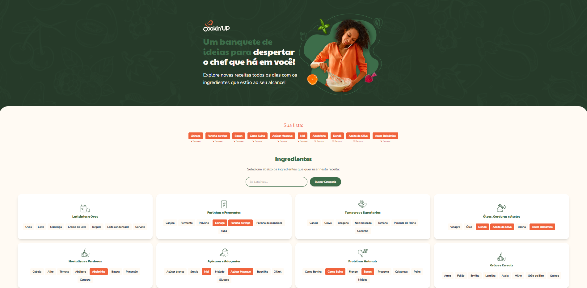
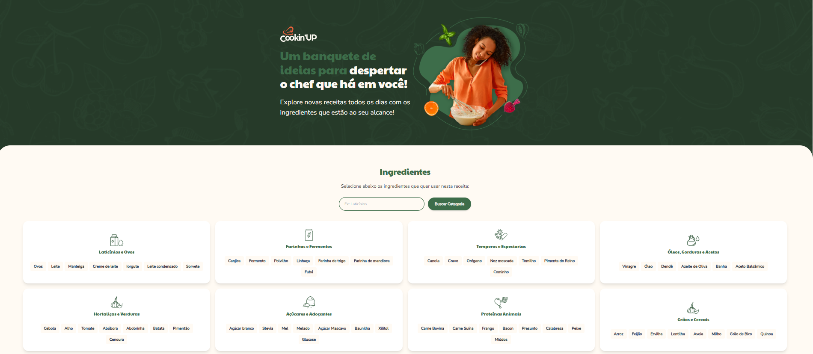
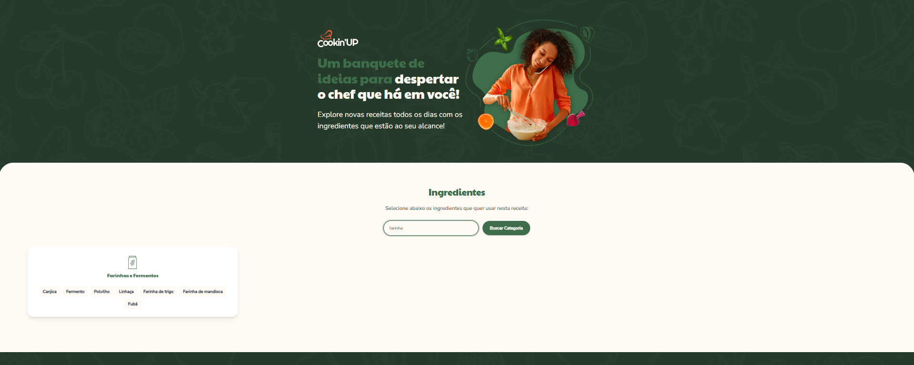

# CookinUp

Aplicação full stack para explorar categorias de ingredientes, pesquisar uma categoria e montar uma lista de ingredientes para usar em uma receita.

## Prévia







## Funcionalidades

- Lista categorias e ingredientes armazenados em SQLite.
- Pesquisa categorias pelo nome.
- Permite selecionar e remover ingredientes da lista.
- Interface responsiva construída com React e Tailwind CSS.

## Tecnologias

- **Frontend:** React, Vite e Tailwind CSS
- **Backend:** Node.js, Express e Prisma
- **Banco de dados:** SQLite

## Requisitos

Instale [Node.js](https://nodejs.org/) (inclui npm) antes de começar.

## Como executar localmente

Abra a pasta do repositório no Visual Studio Code. No menu **Terminal → New Terminal**, inicie o backend e o frontend em terminais separados.

### 1. Configurar e iniciar o backend

No primeiro terminal, execute a partir da pasta raiz do repositório:

```powershell
cd "cookinup backend"
npm install
if (-not (Test-Path .env)) { Copy-Item .env.example .env }
npm run db:setup
npm run dev
```

A API ficará disponível em `http://localhost:3000`. Mantenha esse terminal aberto enquanto usa a aplicação.

### 2. Iniciar o frontend

Abra um segundo terminal. Se ele abrir na raiz do repositório, execute:

```powershell
cd "cookinup frontend"
npm install
npm run dev
```

Abra no navegador o endereço mostrado pelo Vite, normalmente `http://localhost:5173`. Mantenha também esse terminal aberto.

> Se o terminal já estiver dentro de uma das pastas, volte à raiz com `cd ..` antes de executar os comandos correspondentes.

## Endpoints da API

- `GET /categorias`: lista categorias e ingredientes.
- `GET /categorias?busca=frutas`: filtra categorias pelo nome.

O frontend usa `http://localhost:3000` como endereço padrão da API. Para usar outro endereço, crie um arquivo `.env` em `cookinup frontend`:

```env
VITE_API_URL=http://localhost:3000
```

## Scripts disponíveis

No frontend (`cookinup frontend`):

- `npm run dev`: inicia o servidor de desenvolvimento.
- `npm run build`: gera a versão de produção.
- `npm run lint`: verifica problemas de lint.
- `npm run preview`: serve localmente a versão compilada.

No backend (`cookinup backend`):

- `npm run dev`: inicia a API com reinicialização automática.
- `npm run db:setup`: gera o Prisma Client, aplica as migrations e popula o banco com dados de exemplo.

O banco SQLite de desenvolvimento é criado no diretório `prisma/` do backend. O seed usa `db.json` como fonte dos dados de exemplo.

## Estrutura do projeto

```text
.
├── cookinup backend/
├── cookinup frontend/
├── docs/
│   ├── cookinup-busca.png
│   ├── cookinup-categorias.png
│   └── cookinup-lista.png
└── README.md
```
